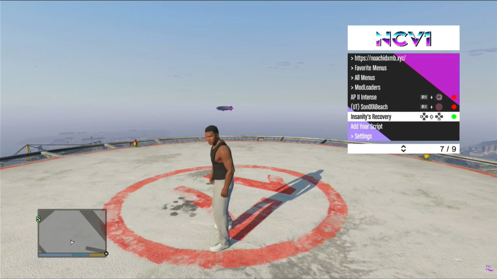
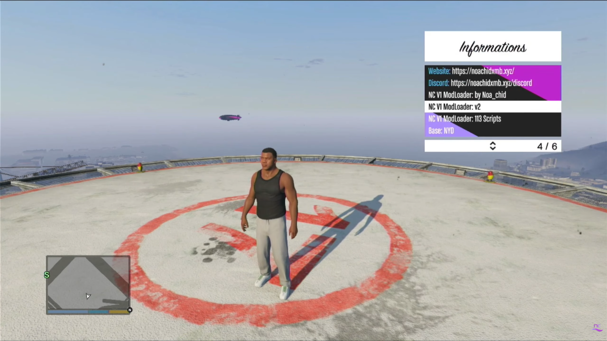
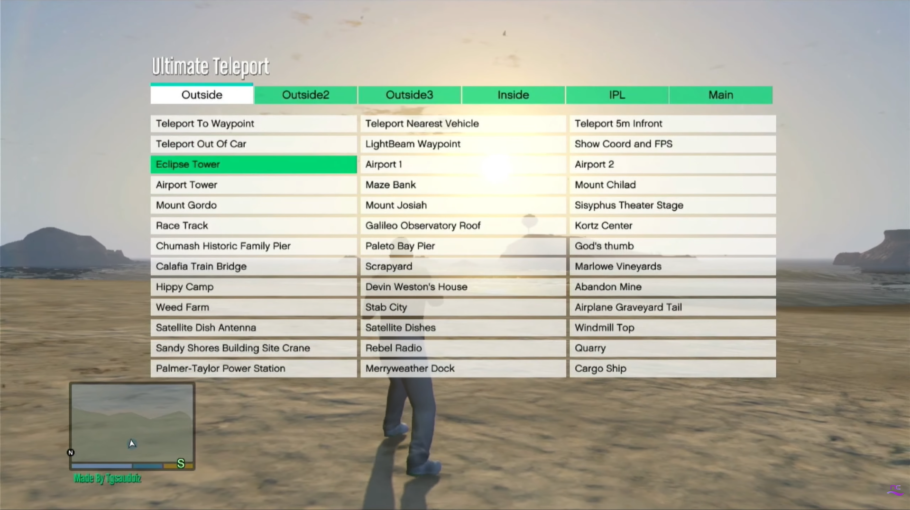

[Vous retrouverez ici le source code au **COMPLET**.](https://drive.google.com/file/d/175Zubkp1FWjL7sEelcsJAbfZsrge5-G0/view?usp=sharing)

# GTA V PS3 : NCV1 ModLoader v2.1 SOURCE CODE

Le **NCV1 ModLoader** est un modloader emblématique de la communauté **GTA ONLINE sur PS3**, apparu à la sortie de RE:V. Développé à partir des sources du **NotYourDope (NYD)**, il s’est rapidement imposé comme un outil incontournable pour les joueurs souhaitant personnaliser leur expérience de jeu.

Porté par la communauté et notamment par le [**Noa_chid’s XMB**](https://www.noachidxmb.xyz/), le NC V1 ModLoader a su évoluer et perdurer au fil du temps, laissant son empreinte dans l’histoire du modding sur PS3.

Son approche repose sur un principe simple : proposer des fonctionnalités innovantes tout en conservant une utilisation accessible et intuitive. Un équilibre entre simplicité, personnalisation et efficacité qui a contribué à faire sa réputation auprès des joueurs.

**Plus qu’un simple modloader, le NCV1 représente une partie de l’héritage du modding sur GTA ONLINE PS3**, témoignant du travail et de la passion d’une communauté déterminée à faire vivre ses créations.

> Voir NCV1 ModLoader V2 sur YouTube

[](https://youtu.be/TmcjbBF2J9M?si=sa4-OieLWNPPSPIC)
> Voir NCV1 ModLoader V1 sur YouTube

[](https://youtu.be/w_9eOTsuOl4?si=0K8nI-NVFm_WIw2Y)

# Discord
L'historique de l'avancement du NCV1 ModLoader sera continuellement [disponible ici](https://discord.gg/KKTWRF8bkg).

# SC-CL
[SC-CL](https://bitbucket.org/scclteam/sc-cl) est un compilateur Clang visant les formats des scripts de Rockstar Games.

## Il prend en charge ces différents formats :
* Grand Theft Auto 4
  * SCO format
* Red Dead Redemption
  * SCO format
  * XSC format
  * CSC format
* Grand Theft Auto 5
  * XSC format
  * CSC format
  * YSC format
  
## Comment l'utiliser ?

```console
USAGE: SC-CL.exe [options] <source0> [... <sourceN>]

OPTIONS:

Clang Options:

  -extra-arg=<string>        - Additional argument to append to the compiler command line
  -extra-arg-before=<string> - Additional argument to prepend to the compiler command line
  -p=<string>                - Build path

Compiler Options:

  Choose obfuscation level:  (This option is experimental use at your own risk)
    -Fs                      - Obfuscate string table - GTA V Only
    -F1                      - Enable low obfuscations
    -F2                      - Enable default obfuscations
    -F3                      - Enable high obfuscations
    -F4                      - Enable very high obfuscations
    -F5                      - Enable max obfuscations
  Choose optimization level:
    -g                       - No optimizations, enable debugging
    -O1                      - Enable trivial optimizations
    -O2                      - Enable default optimizations
    -O3                      - Enable expensive optimizations
  -emit-asm                  - Emits the pre compiled ASM representation of the script
  -emit-asm-only             - Only emits the pre compiled ASM representation of the script
  -hvi=<uint>                - Sets the starting index for host variables to ignore
  -hvs=<uint>                - Sets the amount of host variables to ignore
  -n                         - Disable function names in script output, Enabled when optimisations are turned on
  -name=<string>             - File name of output script, defaults to input file name
  -no-rsc7                   - Removes the RSC7 header from the output (GTAV)
  -out-dir=<string>          - Specify the output directory of the script
  -pc-version=<uint>         - Sets the pc version for use in the native translation table
  -platform                  - Choose target platform:
    =X360                    -   Target Xbox (32 bit, big endian)
    =PS3                     -   Target PS3 (32 bit, big endian)
    =PC                      -   Target PC (64 bit, little endian)
  -pvi=<uint>                - Sets the starting index for player variables to ignore
  -pvs=<uint>                - Sets the amount of player variables to ignore
  -s                         - Limits script to one instance on runtime (GTAV | GTAIV)
  -target                    - Choose build target:
    =GTAIV                   -   Grand Theft Auto IV (sco output)
    =GTAIV_TLAD              -   Grand Theft Auto IV The Lost and Damned (sco output)
    =GTAIV_TBOGT             -   Grand Theft Auto IV The Ballad of Gay Tony (sco output)
    =GTAV                    -   Grand Theft Auto V (#sc output)
    =RDR_SCO                 -   Red Dead Redemption (sco output)
    =RDR_#SC                 -   Red Dead Redemption (#sc output)
  -vcx=<vcxproj path>        - Parses source files out of a vcxproj file to allow for seamless linking in Visual Studio

General options:

  -stats                     - Enable statistics output from program (available with Asserts)

Generic Options:

  -help                      - Display available options (-help-hidden for more)
  -help-list                 - Display list of available options (-help-list-hidden for more)
  -version                   - Display the version of this program
```

### Voici quelques images du ModLoader




