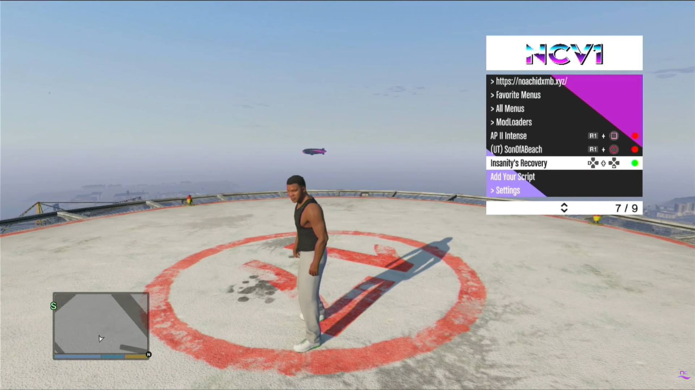
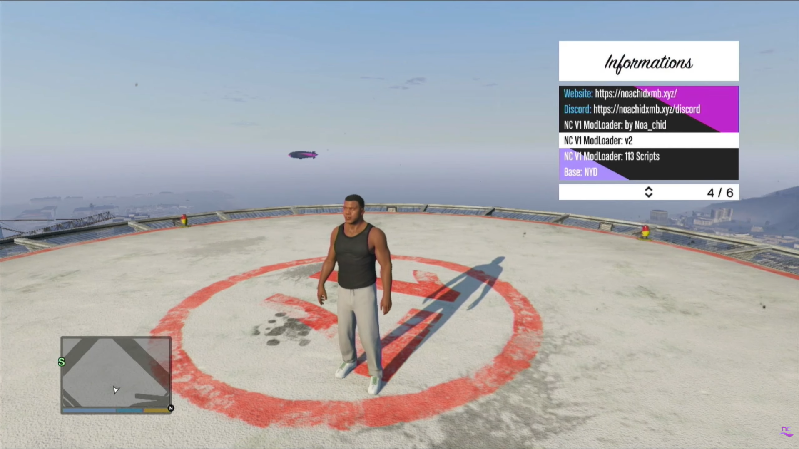
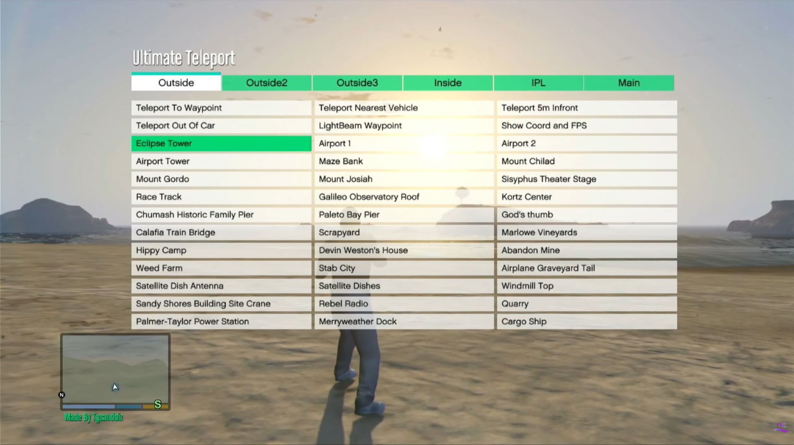

<div align="center">

# 🎮 GTA V PS3 — NCV1 ModLoader v2.1

**Modloader pour GTA Online sur PlayStation 3 — code source C et outils de compilation**


[Code source complet (archive ZIP)](https://drive.google.com/file/d/175Zubkp1FWjL7sEelcsJAbfZsrge5-G0/view?usp=sharing) · [Site de Noa_chid’s XMB](https://www.noachidxmb.xyz/) · [Discord du projet](https://www.noachidxmb.xyz/discord)



</div>

---

## Sommaire

- [Pourquoi ce projet ?](#pourquoi-ce-projet-)
- [Fonctionnalités](#fonctionnalités)
- [Stack technique](#stack-technique)
- [Démarrage rapide](#démarrage-rapide)
- [Configuration](#configuration)
- [Utilisation](#utilisation)
- [Structure du projet](#structure-du-projet)
- [Sécurité](#sécurité)
- [Licence](#licence)
- [Auteur](#auteur)
- [SC-CL](#sc-cl)
- [Présentations vidéo](#présentations-vidéo)
- [Captures du modloader](#captures-du-modloader)

## Pourquoi ce projet ?

Ce projet a été créé pour fidéliser les utilisateurs GTAV et GTA Online du [Noa_chid's XMB](https://www.noachidxmb.xyz/) (projet annexe de RIBOTE--MORAL Noa) suite à une demande excessive.

## Fonctionnalités

- Menus organisés par catégories : mod menus, récupération, protections, freeze, téléportation, tenues, véhicules, modèles et menus fun
- Lancement et arrêt des scripts GTA V accessibles dans l’environnement de jeu
- Raccourcis de lancement affichés dans le menu pour les scripts qui en définissent
- Jusqu’à dix emplacements de scripts personnalisés, ajoutés par leur nom
- Personnalisation de l’arrière-plan, de l’opacité, des couleurs, de la position du menu et de l’effet glare
- Menu d’informations indiquant NC V1 ModLoader v2.1, Noa_chid, la base NYD et 113 scripts annoncés

## Stack technique

| Couche | Technologie / format |
| --- | --- |
| Langage du modloader | C (sources `.c` et `.h`) |
| Compilateur | [SC-CL](https://bitbucket.org/scclteam/sc-cl), compilateur Clang pour scripts Rockstar |
| Jeu ciblé par ce projet | Grand Theft Auto V |
| Plateforme cible du script fourni | PlayStation 3 (32 bits, big endian) |
| Sortie compilée | Script `.csc` ; représentation assembleur `.csa2` également fournie |
| Bibliothèques | En-têtes SC-CL et bibliothèque commune dans `include/` |
| Scripts d’automatisation | Batch Windows (`.bat`) |

## Démarrage rapide

### Prérequis

- Windows pour exécuter les scripts batch fournis.
- Les fichiers SC-CL et bibliothèques distribués dans `bin/` (inclus dans ce dépôt).

### Compilation

Depuis `projects/ModLoader`, lancez `compile.bat`. Il compile `ModLoader.c` avec `include/common.c` pour **GTA V sur PS3**, puis place les sorties dans `GTAV/PS3/bin/`.

```bat
compile.bat
```

La commande SC-CL appelée par le script est :

```bat
"../../bin/SC-CL.exe" -emit-asm -platform=PS3 -target=GTAV -out-dir="GTAV/PS3/bin/" ModLoader.c ../../include/common.c -- -I "../../include/"
```

Les fichiers compilés `ModLoader.csc` et `ModLoader.csa2` sont déjà présents dans `projects/ModLoader/GTAV/PS3/bin/`.

## Configuration

Le dépôt ne contient pas de fichier de configuration séparé (`.env`, fichier INI ou équivalent). Les paramètres du menu sont déclarés dans les sources, principalement `projects/ModLoader/vars.h` et `projects/ModLoader/ModLoader.c`.

Quelques valeurs définies dans le code :

| Paramètre | Valeur / emplacement |
| --- | --- |
| Combinaison d’ouverture | Contrôles `185` et `186` (`Bind1` et `Bind2` dans `vars.h`) |
| Arrière-plan initial | Dictionnaire `NCBG12`, texture `classicvinewood_texture_1` |
| Opacité initiale du fond | `BackgroundA = 20` |
| Scripts personnalisés | Jusqu’à 10 emplacements |
| Adresse utilisée par le script d’injection | `192.168.1.105` dans `injector and compile.bat` ; à adapter à l’environnement concerné |

## Utilisation

Le modloader est un script de jeu GTA V. Une fois chargé dans l’environnement de jeu compatible, il affiche son menu et permet de naviguer entre les catégories, lancer ou arrêter les scripts disponibles et régler l’apparence du menu. La disponibilité d’un script dépend de sa présence et de son accessibilité dans le jeu.

Les contrôles de navigation et d’ouverture sont définis dans le code. Le menu affiche les raccourcis associés aux scripts lorsqu’ils sont configurés. Les emplacements personnalisés permettent de saisir le nom d’un script, de choisir une taille de pile parmi les valeurs prévues par le code, puis de le lancer ou de l’arrêter.

### Scripts de compilation fournis

| Script | Rôle observé dans le dépôt |
| --- | --- |
| `projects/ModLoader/compile.bat` | Compile le modloader pour PS3 et génère aussi la représentation assembleur. |
| `projects/ModLoader/injector and compile.bat` | Compile puis tente d’injecter le `.csc` avec `Script Injector.exe` à l’adresse IP inscrite dans le script. L’injecteur n’est pas inclus dans `bin/`. |
| `projects/ModLoader/compile project.bat` | Exemple générique Xbox 360/Visual Studio faisant référence à `example.vcxproj`, absent du dépôt. |

## Structure du projet

```text
.
├── bin/                              # SC-CL et bibliothèques nécessaires
├── images/                           # Captures du menu et vignettes vidéo
├── include/                          # En-têtes SC-CL et bibliothèque commune
│   ├── GTAIV/                        # Définitions GTA IV
│   ├── GTAV/                         # Définitions GTA V
│   └── RDR/                          # Définitions Red Dead Redemption
├── projects/
│   ├── Create SC-CL Project.exe      # Outil fourni de création de projet SC-CL
│   └── ModLoader/
│       ├── ModLoader.c               # Point d’entrée et menus
│       ├── functions.h               # Fonctions du menu et de lancement des scripts
│       ├── vars.h                    # Variables et réglages initiaux
│       ├── enums.h                   # Énumération des boutons
│       ├── BackgroundOptions.h       # Options liées aux fonds et à l’affichage
│       ├── *.bat                     # Scripts de compilation / injection
│       └── GTAV/PS3/bin/
│           ├── ModLoader.csc         # Script compilé pour PS3
│           └── ModLoader.csa2        # Représentation assembleur compilée
├── README.md
└── readme_ex.md                      # Modèle de README présent dans le dépôt
```

## Sécurité

Ce dépôt est un projet de modding pour un jeu vidéo et ne contient pas de service web ni de système de comptes. Le script d’injection fourni utilise une adresse IP codée en dur (`192.168.1.105`) : adaptez-la à votre environnement avant utilisation. L’injecteur référencé par le batch n’est pas inclus dans `bin/`.

## Licence

- Licence MIT

## Auteur

Le menu du projet indique **by Noa_chid** soit RIBOTE--MORAL Noa, et **NYD**. Le projet est associé à [Noa_chid’s XMB](https://www.noachidxmb.xyz/), créer par RIBOTE--MORAL Noa.

## SC-CL

[SC-CL](https://bitbucket.org/scclteam/sc-cl) est un compilateur Clang ciblant plusieurs formats de scripts Rockstar Games. Le dépôt fournit l’exécutable `bin/SC-CL.exe` ainsi que les en-têtes associés dans `include/`.

Formats annoncés dans la documentation conservée du README précédent :

- **Grand Theft Auto IV** : format SCO, avec les cibles GTA IV, The Lost and Damned et The Ballad of Gay Tony.
- **Red Dead Redemption** : formats SCO, `#SC`, XSC et CSC.
- **Grand Theft Auto V** : formats `#SC`, XSC, CSC et YSC.

### Options SC-CL

```console
USAGE: SC-CL.exe [options] <source0> [... <sourceN>]

OPTIONS:

Clang Options:

  -extra-arg=<string>        - Additional argument to append to the compiler command line
  -extra-arg-before=<string> - Additional argument to prepend to the compiler command line
  -p=<string>                - Build path

Compiler Options:

  Choose obfuscation level:  (This option is experimental use at your own risk)
    -Fs                      - Obfuscate string table - GTA V Only
    -F1                      - Enable low obfuscations
    -F2                      - Enable default obfuscations
    -F3                      - Enable high obfuscations
    -F4                      - Enable very high obfuscations
    -F5                      - Enable max obfuscations
  Choose optimization level:
    -g                       - No optimizations, enable debugging
    -O1                      - Enable trivial optimizations
    -O2                      - Enable default optimizations
    -O3                      - Enable expensive optimizations
  -emit-asm                  - Emits the pre compiled ASM representation of the script
  -emit-asm-only             - Only emits the pre compiled ASM representation of the script
  -hvi=<uint>                - Sets the starting index for host variables to ignore
  -hvs=<uint>                - Sets the amount of host variables to ignore
  -n                         - Disable function names in script output, Enabled when optimisations are turned on
  -name=<string>             - File name of output script, defaults to input file name
  -no-rsc7                   - Removes the RSC7 header from the output (GTAV)
  -out-dir=<string>          - Specify the output directory of the script
  -pc-version=<uint>         - Sets the pc version for use in the native translation table
  -platform                  - Choose target platform:
    =X360                    -   Target Xbox (32 bit, big endian)
    =PS3                     -   Target PS3 (32 bit, big endian)
    =PC                      -   Target PC (64 bit, little endian)
  -pvi=<uint>                - Sets the starting index for player variables to ignore
  -pvs=<uint>                - Sets the amount of player variables to ignore
  -s                         - Limits script to one instance on runtime (GTAV | GTAIV)
  -target                    - Choose build target:
    =GTAIV                   -   Grand Theft Auto IV (sco output)
    =GTAIV_TLAD              -   Grand Theft Auto IV The Lost and Damned (sco output)
    =GTAIV_TBOGT             -   Grand Theft Auto IV The Ballad of Gay Tony (sco output)
    =GTAV                    -   Grand Theft Auto V (#sc output)
    =RDR_SCO                 -   Red Dead Redemption (sco output)
    =RDR_#SC                 -   Red Dead Redemption (#sc output)
  -vcx=<vcxproj path>        - Parses source files out of a vcxproj file to allow for seamless linking in Visual Studio

General options:

  -stats                     - Enable statistics output from program (available with Asserts)

Generic Options:

  -help                      - Display available options (-help-hidden for more)
  -help-list                 - Display list of available options (-help-list-hidden for more)
  -version                   - Display the version of this program
```

## Présentations vidéo

[](https://youtu.be/TmcjbBF2J9M?si=sa4-OieLWNPPSPIC)

> Voir NCV1 ModLoader V2 sur YouTube

[](https://youtu.be/w_9eOTsuOl4?si=0K8nI-NVFm_WIw2Y)

> Voir NCV1 ModLoader V1 sur YouTube

## Captures du modloader




